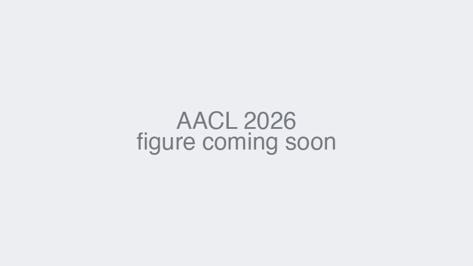
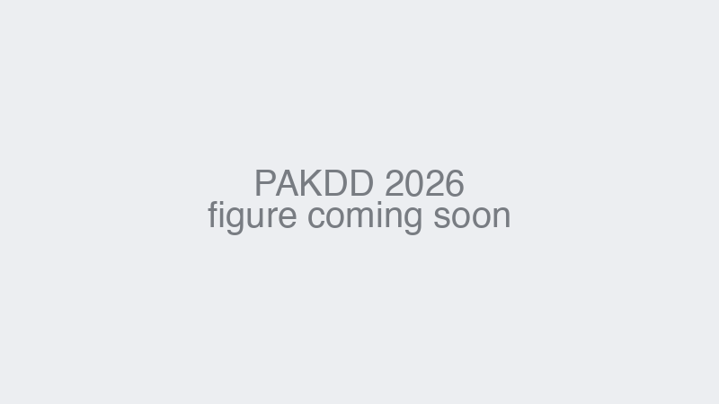

<!-- AACL 2026 (TODO: Code link) -->
<table width="100%" cellspacing="0" cellpadding="4">
  <tr>
    <td width="48%" valign="middle">
      
    </td>
    <td width="52%" valign="middle">
      <h2>
        <a href="https://arxiv.org/abs/2610.21347">
          Emotion Is Not External Knowledge: Internal Attention Signals for Affective State Reasoning
        </a>
      </h2>
      
🔥 <b>2026.10.15</b>

      
<i>Annual Conference of the Asia-Pacific Chapter of the ACL (AACL 2026), Main Conference</i>

      
<a href="https://arxiv.org/abs/2610.21347">[arXiv]</a> <a href="#">[Code]</a>

    </td>
  </tr>
</table>

<!-- INTERSPEECH 2026 -->
<table width="100%" cellspacing="0" cellpadding="4">
  <tr>
    <td width="48%" valign="middle">
      
    </td>
    <td width="52%" valign="middle">
      <h2>
        <a href="https://www.isca-archive.org/interspeech_2026/tang26b_interspeech.html">
          DeSRPA: Decoupled Speech Role-Playing Agent via Inference-Time Intervention
        </a>
      </h2>
      
🔥 <b>2026.09</b>

      
<i>INTERSPEECH 2026</i>

      
<a href="https://www.isca-archive.org/interspeech_2026/tang26b_interspeech.html">[Paper]</a> <a href="https://arxiv.org/abs/2606.17669">[arXiv]</a> <a href="https://steeremo971-commits.github.io/emosteer-tts-demo/">[Demo]</a> <a href="https://github.com/steeremo971-commits/DeSRPA">[Code]</a>

    </td>
  </tr>
</table>

<!-- PAKDD 2026 -->
<table width="100%" cellspacing="0" cellpadding="4">
  <tr>
    <td width="48%" valign="middle">
      
    </td>
    <td width="52%" valign="middle">
      <h2>
        <a href="https://link.springer.com/chapter/10.1007/978-981-92-1947-6_33">
          Facet-Level Persona Control by Trait-Activated Routing with Contrastive SAE
        </a>
      </h2>
      
🔥 <b>2026.06.25</b>

      
<i>Pacific-Asia Conference on Knowledge Discovery and Data Mining (PAKDD 2026)</i>

      
<a href="https://link.springer.com/chapter/10.1007/978-981-92-1947-6_33">[Paper]</a> <a href="https://arxiv.org/abs/2602.19157">[arXiv]</a> <a href="https://github.com/lunat5078/BigFive-Personality-Facets-Dataset">[Code]</a>

    </td>
  </tr>
</table>
